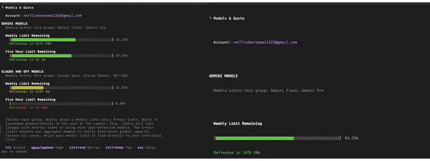

# Paste Screenshot as CSS



Copy a screenshot to the clipboard. Press `Cmd+Shift+V`. Get back HTML + CSS
(or Tailwind, or inline styles) at your cursor. Bring your own Cent AI key —
no account, no backend, no subscription.

## What it does

1. You copy a screenshot (Figma frame, a browser, a PDF mockup — anything)
   to the macOS clipboard.
2. You run **Paste Screenshot as CSS** (`Cmd+Shift+V`) in any open file.
3. The extension reads the image straight off the clipboard, sends one
   vision request to Cent AI with your own API key, and inserts the
   generated markup at your cursor — indentation-matched, undoable with a
   single `Cmd+Z`.
4. Not happy with how shallow the first pass is? Run
   **Paste Screenshot as CSS: Regenerate with More Detail** to re-prompt the
   same image with an instruction to go further on spacing/shadows/nested
   elements.

Three output flavors, picked once and remembered: **Tailwind classes**,
**plain CSS**, or **inline `style=` attributes**.

Nothing is uploaded anywhere except straight to Cent AI, using your own key.
The extension has no backend, no telemetry, and keeps no history of your
screenshots or generated code.

## Install & setup

1. Install the extension (from a packaged `.vsix` — see `TASKS.md` for the
   Marketplace-publish status).
2. Run **Paste Screenshot as CSS: Set Cent AI API Key** once (stored in VS
   Code's `SecretStorage`, never written to `settings.json`).
3. Copy a screenshot to the clipboard, open a file, press `Cmd+Shift+V`
   (`Ctrl+Shift+V` on Windows/Linux keybinding, though the extension itself
   is macOS-only for now — see Limitations).
4. First run also prompts you to pick an output flavor
   (**Paste Screenshot as CSS: Set Output Style** to change it later).

```bash
# to build/test from source instead of a .vsix:
npm install
npm run compile
npm test
```

## Pricing

Free and fully functional — bring your own Cent AI API key, no gating, no
license check. If it saves you real time, there's an honor-pricing link to
pay once (no subscription, no tiers): see `requirements/PRICING_DECISION.md`
for the reasoning and the concrete number.

Your own Cent AI usage cost is separate and yours — a typical screenshot
call runs well under a cent at `claude-haiku-5.5` pricing, cheap enough not
to budget around.

## Limitations

- **macOS only.** Clipboard image reading shells out to `osascript`; no
  Windows/Linux support yet.
- Dense screenshots (long lists, big tables, detailed maps) get capped at
  8-10 representative elements per prompt instruction, rather than
  enumerating every instance — see `requirements/PROMPT_REFINEMENT.md`.
- No pixel-perfect guarantee — see `requirements/DEMO.md` for real
  before/after comparisons and honest SSIM scores against source
  screenshots (0.59-0.72 across the tested fixtures: structurally faithful,
  not 1:1 on exact spacing).

## More detail

- `requirements/PRD.md` — original product spec.
- `requirements/DEMO.md` — real before/after visual-fidelity QA, with the
  source video the hero GIF above was cut from.
- `requirements/PROMPT_REFINEMENT.md` — what changed in the vision prompt
  and why.
- `requirements/CODE_REVIEW_V1.md` — security/code-review findings.
- `requirements/PRICING_DECISION.md` — pricing rationale.
- `TASKS.md` — full build log, including what's still blocked and why.
