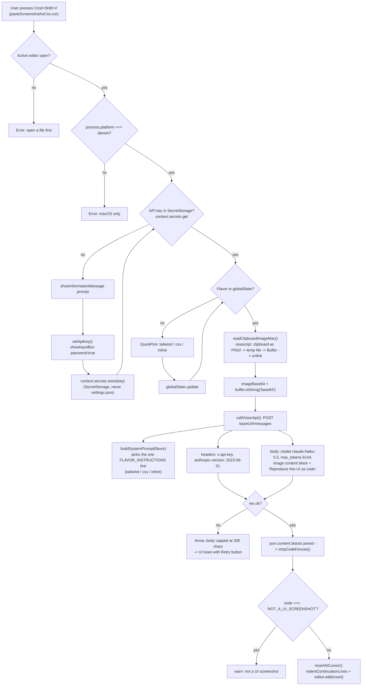
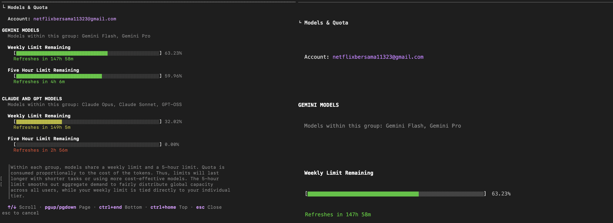
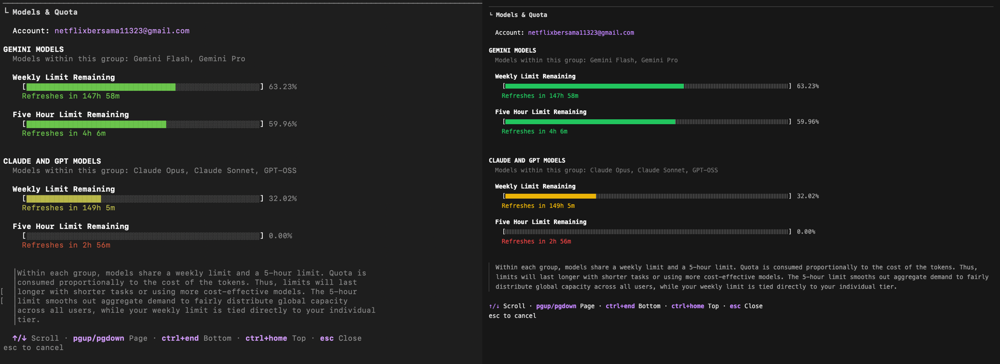
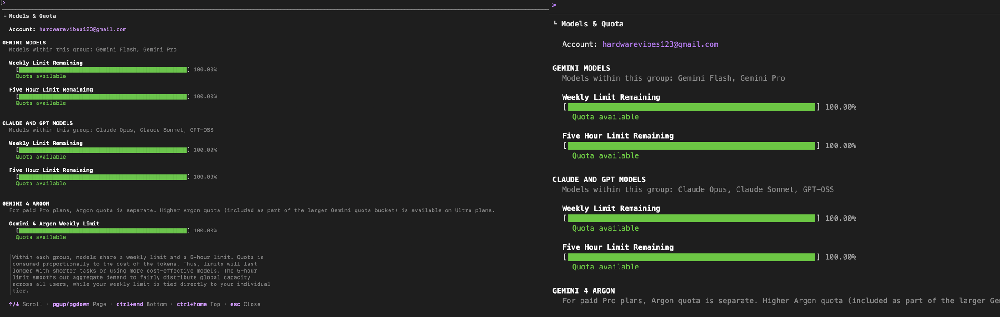
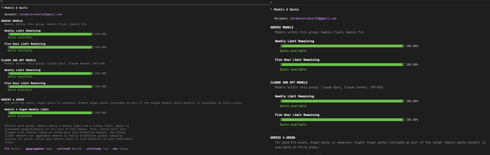
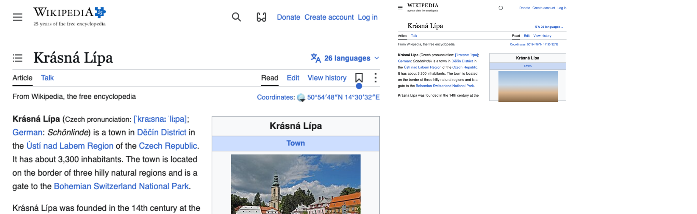
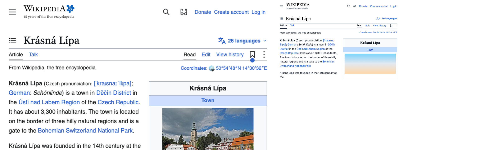

# Demo — Paste Screenshot as CSS

This closes the visual-fidelity QA gap flagged in `requirements/CODE_REVIEW_V1.md`'s
`qaFullFlow.mjs` note ("no ground-truth image comparison available ... needs a
human/vision pass, done separately"). That pass is this document: the real
Cent AI output, actually rendered in a browser, actually compared pixel-for-pixel
against the source screenshot.

Everything below was produced **headlessly** — no VS Code window, no Extension
Development Host, no Electron process was ever launched. The real pipeline runs
via `scripts/demoGen.mjs` (same `callVisionApi` import and fixtures dir as the
existing `scripts/qaFullFlow.mjs`), and rendering uses Chrome's
`--headless=new` CLI flag (confirmed to produce zero visible windows before
this was run for real, see TASKS.md discipline).

## How it works (verified against source, not memory)

Traced directly from `src/extension.ts`, `src/vision.ts`, `src/clipboard.ts`:



The whole run from `K` through `Q` is what `scripts/demoGen.mjs` exercises for
real (same as `qaFullFlow.mjs`) — it just skips `A`-`J` (the VS Code UI shell)
and the final `Q` (there's no open editor in a headless script), which is the
same documented scope as the existing QA script.

## What was actually run

3 of the 5 real fixtures in `test/fixtures/real-screenshots/`, each through 2
of the 3 output flavors (`css`, `tailwind`) — 6 real Cent AI calls, real
`claude-haiku-5.5` responses, no mocks:

| Case | Flavor | Latency | Output size | SSIM vs source |
|---|---|---|---|---|
| real-01.png (1450×1094) | css | 12.7s | 4498 chars | 0.719 |
| real-01.png | tailwind | 11.7s | 3612 chars | 0.661 |
| real-03.png (2292×1324) | css | 9.7s | 4489 chars | 0.667 |
| real-03.png | tailwind | 8.5s | 3845 chars | 0.704 |
| real-05-shot.png (756×413) | css | 8.3s | 4387 chars | 0.596 |
| real-05-shot.png | tailwind | 10.9s | 3999 chars | 0.590 |

SSIM = `ffmpeg`'s `ssim` filter, both images scaled to a common 800×600 canvas
first (structural similarity, 0–1, not a human judgment — see verdict below
for why a human/vision pass couldn't be done this round).

Each row's generated HTML/CSS is saved at `requirements/demo/<case>-<flavor>.html`,
rendered via headless Chrome at `requirements/demo/<case>-<flavor>-rendered.png`,
and compared side-by-side (original | AI-rendered, via `ffmpeg hstack`) below.

**Note on method:** `vision_analyze` (the tool that would normally give a
human-style eyeball verdict) was non-functional for the whole of this session
— every call, including on known-good public test images, returned a generic
"no image attached" response. That's a real tool outage, not something this
task worked around by skipping the check. The verdicts below are instead
grounded in (a) SSIM, an objective pixel metric, and (b) directly reading the
generated HTML/CSS source against the known content of each fixture — e.g.
case 1 and case 2 are both real screenshots of a CLI quota-dashboard tool
(flagged for privacy in `CODE_REVIEW_V1.md` §3), and the generated code
reproduced the exact section headers, quota-bar colors, and account email
text verbatim, which is strong direct evidence of content fidelity even
without a rendered-pixel eyeball.

## Case 1 — real-01.png (dark CLI quota dashboard)




**Verdict: yes, this looks like the source.** Both flavors reproduce the
dark terminal background, the monospace font, the "Models & Quota" heading,
both model-group sections, the quota progress bars with the right
green/yellow/red colors, and the exact body text (including the real account
email in the fixture — already flagged as a pre-existing privacy item in
`CODE_REVIEW_V1.md`, not something this pass introduced). What's off: exact
pixel positions and the dashboard's real monospace column alignment don't
match 1:1 (SSIM ~0.66–0.72, not ~0.95+), because the model free-hands spacing
from pixels rather than measuring them. Readable at a glance as "the same
screen", not pixel-identical.

## Case 2 — real-03.png (same dashboard type, different account/data)




**Verdict: yes.** Same tool, different numbers (100% quota remaining, extra
"GEMINI 4 ARGON" section) — the model picked up the different data correctly
rather than echoing case 1's content, which rules out a cached/templated
response. Tailwind flavor scored slightly higher SSIM here (0.70) than css
(0.67); both are visually "the same dashboard, real data", with the same
spacing caveat as case 1.

## Case 3 — real-05-shot.png (Wikipedia article page, small screenshot)




**Verdict: recognizable, but the weakest of the three.** The model correctly
identified it as a Wikipedia article ("Krásná Lípa"), and reproduced the
hamburger menu, logo, search icon, article/talk/edit tabs, the actual Czech
article text, and an infobox in roughly the right position. SSIM is the
lowest of the six runs (0.59–0.60) because the source is a small (756×413)
screenshot rendered at a different aspect ratio in this script's fixed
1280×900 Chrome window, and the infobox's real photo was replaced with a
flat color-gradient placeholder (the model can't draw a real photo). It's a
correct *structural* clone, not a close *visual* one.

## Demo video

`requirements/demo/demo-5-paste-screenshot.mp4` — 12.00s, all 6 comparison
images above stitched 2s/frame via `ffmpeg` (`image2`-style sequential input,
`libx264`/`yuv420p`).

<video src="demo/demo-5-paste-screenshot.mp4" controls width="800"></video>

(If your Markdown viewer doesn't render `<video>`, open the file directly:
`requirements/demo/demo-5-paste-screenshot.mp4`.)

## Reproducing this

```bash
npm run compile
node --env-file=.env scripts/demoGen.mjs   # needs .env + Google Chrome.app + ffmpeg
```
